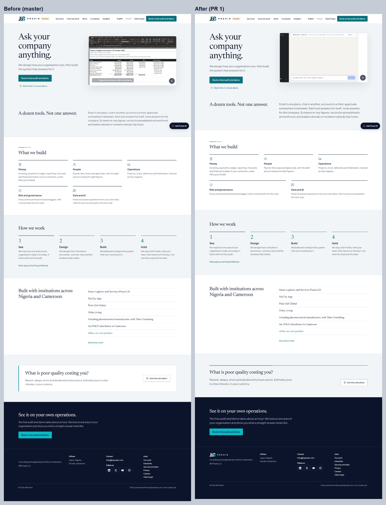
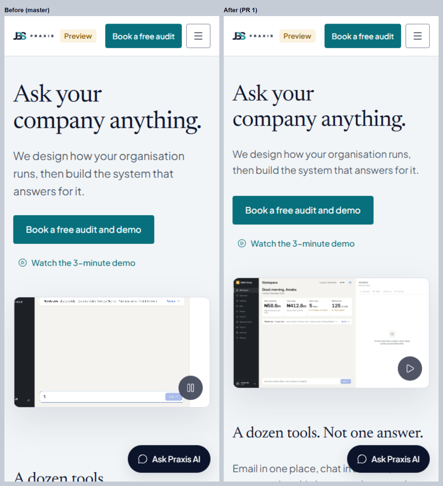
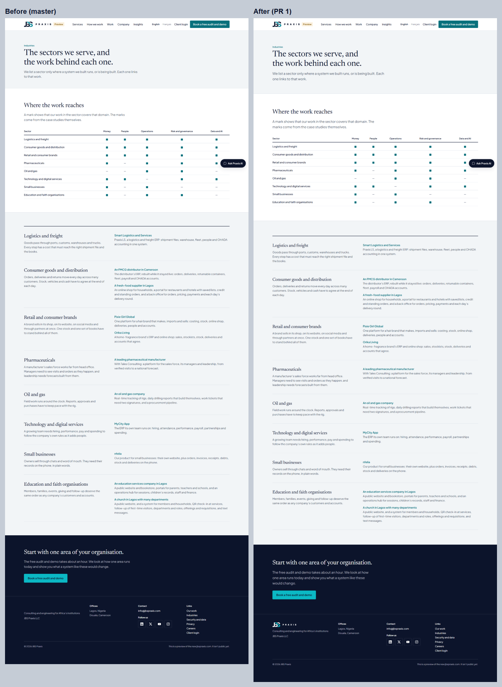
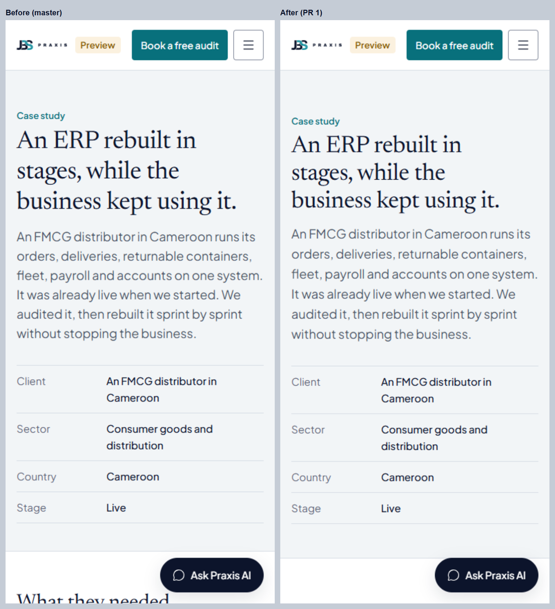

# PR 1: Foundation (design tokens, type, spacing, components, speed and accessibility)

Branch `redesign/pr1-foundation`, on `main` (the clean snapshot of `master` 4fc597c that starts the GitHub repo). Deploy the usual cPanel way (`docs/LAUNCH_SET.md`).

**Not deployed. Nothing on jbspraxis.com has changed.**

## What changed

### 1. Token layer (`resources/css/app.css`)
- **Type scale:** one fluid scale, built from brand book §8. Each size runs from the mobile value at 375 px to the desktop value at 1280 px:
  - display 40→64
  - H1 34→48
  - H2 28→36
  - H3 22→26
  - headline number 40→56
  - lead 18→20

  Before, components set their own sizes, and they had drifted: the mobile display was 44 instead of 40, and section titles were 30 instead of 28.
- **Spacing:** `--space-1…10` covers the only allowed steps (4–128 px). `--section-y` (64→88 px), `--section-y-tight` and `--gutter` set the rhythm between sections.
- **Motion:** adds the two durations PR 2 needs (`--motion-data` 600 ms, `--motion-story` 1200 ms) and `--ease-linear`. All of them collapse under reduced motion.
- **Fonts:** metric-matched fallbacks (Georgia and Arial resized with Capsize metrics), so text doesn't move when Newsreader and Plus Jakarta Sans arrive.
- **Wiring:** every heading, lead and section now reads the tokens. Seventeen hard-coded sizes and paddings were removed.

### 2. Components
- **New Blade components:**
  - `<x-picture>`: a place photograph, AVIF then WebP at 640, 1280 and 2400 px, with a fixed 3:2 box so nothing jumps. Lazy by default, `:priority` for a hero.
  - `<x-frame>`: a product screen on a Paper or Ink panel, 8 px radius (brand book §10).
  - `<x-section-head>`: a section's H2, an optional lead and the short Praxis rule. Now used on the homepage.
- **Layout fixes:**
  - The five domains no longer leave a hole in a 3 + 2 grid: the second row widens to fill the line.
  - The calculator box was the only card on the site (brand book §9: "Website: no cards"). It now sits under the Praxis rule instead.
  - Two Mist sections in a row no longer stack their padding (the extra gap under the hero).
  - The footer logo never loaded (lazy loading never fired). It now stays lazy, then loads right after the page.

### 3. Speed
- **Hero video (6.4 MB):** `preload="none"`. It downloads and plays only on screens 1080 px or wider, with a fast connection, no Data Saver and no reduced motion, after the page has loaded, and only while it's on screen. Everywhere else the poster shows and the button plays it on request.
- **Poster:** a 24 KB WebP (it was an 85 KB JPEG), fetched first with `fetchpriority="high"`.
- **Icons:** icon slots are sized before the icons draw. The hero's two actions stack, so the play icon no longer wraps the row.
- **Layout shift:** desktop home's CLS goes from 0.17 to 0. The product frame no longer re-centres, and the row of hero actions no longer wraps when the play icon is drawn.
- **Server (`public/.htaccess`):** gzip for HTML, CSS, JS, JSON and SVG. Hashed build files are cached for a year (`immutable`); images and media for 30 days. Every block is in `IfModule`, so it's inert where a module is missing.

### 4. Search and accessibility
- **Breadcrumbs:** `BreadcrumbList` JSON-LD on every page except home: Home › section › page, in English and French. A new `site.nav.home` key ("Home" / "Accueil").
- **Text wrapping:** `text-wrap: pretty` on paragraphs, plus `max-width` and `height: auto` defaults for media.
- **Accessibility:** Lighthouse already scored 100 and still does (see below).

### 5. Images
- The six Gemini place images are in `public/img/place/`, as AVIF and WebP at three widths each. The 1280 px AVIF files are 29–95 KB.
- They're **not placed on pages yet**. PR 3 places them, along with the proof sections.

### 6. Tests
- `tests/Feature/FoundationTest.php` adds 6 tests: breadcrumbs in EN and FR, font preloads from the real build, the video's preload, and the picture component and its files.
- Full suite: **179 passed**.

## Before and after

Lighthouse 12.8 on the local server (`php artisan serve`, the same machine and settings before and after). SEO reads 69 in both runs only because local pages carry `noindex`; it's 100 on the live site.

| Page | Device | Perf before → after | LCP | CLS | Page weight |
|---|---|---|---|---|---|
| Home | Phone | 90 → **90** | 3.0 → 3.2 s | 0.003 → **0** | 3,900 → **453 KiB** |
| Home | Desktop | 90 → **100** | 0.7 → 0.7 s | 0.173 → **0** | 3,966 → 3,717 KiB |
| Case study (FMCG) | Phone | 90 → **91** | 3.2 → 3.0 s | 0.003 → 0 | 362 → 432 KiB* |
| Case study (FMCG) | Desktop | 98 → **100** | 0.6 → 0.7 s | 0.016 → 0 | 362 → 432 KiB* |
| Industries | Phone | 92 → 92 | 2.9 → 2.9 s | 0.003 → 0 | 373 → 443 KiB* |
| Industries | Desktop | 99 → **100** | 0.6 → 0.7 s | 0.003 → 0.001 | 439 → 443 KiB |
| Calculator | Phone | 89 → **91** | 3.3 → 3.0 s | 0.022 → 0 | 426 → 430 KiB |
| Calculator | Desktop | 100 → 100 | 0.7 → 0.6 s | 0.002 → 0 | 426 → 430 KiB |

Accessibility 100 → 100 and Best practices 100 → 100 on every page.

\* +66 KiB: the footer logo now actually loads. Before, it never appeared.

**Home on a phone:** the full page load went from 6.7 MB in 33 s to under 0.5 MB in 1.8 s (Playwright, unthrottled).

**Two things I tried and took back, measured three runs each:**
- Preloading the two fonts pushed the poster (the largest element on a phone) back by 0.7 s: score 88.
- Loading the footer logo eagerly competed with it too: score 89.

What ships: no font preloads (the fallback fonts keep text still without them), and a 24 KB WebP poster fetched first. That's a steady 90.

**Screenshots:** all 14 pages at 1440 px and 390 px are in `audit/2026-11-redesign/pr1/before/` and `after/`. Side-by-side sheets are in `audit/2026-11-redesign/pr1/compare/`:

| | |
|---|---|
| Home, desktop |  |
| Home, phone (first screen) |  |
| Industries, desktop |  |
| Case study, phone (first screen) |  |

## Deploy notes
- Run `npm run build`, then upload `public/build` and `public/img/place`, as usual.
- After deploying, check the gzip: `curl -sI -H "Accept-Encoding: gzip" https://jbspraxis.com/ | grep -i content-encoding`. If it's empty, the host's nginx is serving the HTML itself. In that case, turn on compression and HTTP/2 in cPanel, or move the DNS behind Cloudflare (recommended in the 29 Oct audit). That's a hosting setting, not code.

## Not in this PR
- The sticky header CTA and the calculator journey are PR 3, as decided.
- The motion system, the hero moment, Ask Praxis and brand book v1.4 are PR 2.
