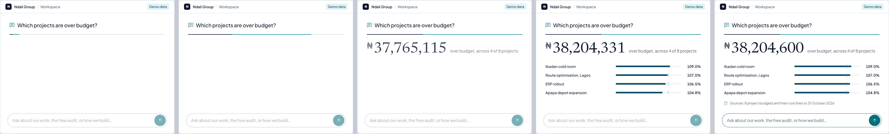
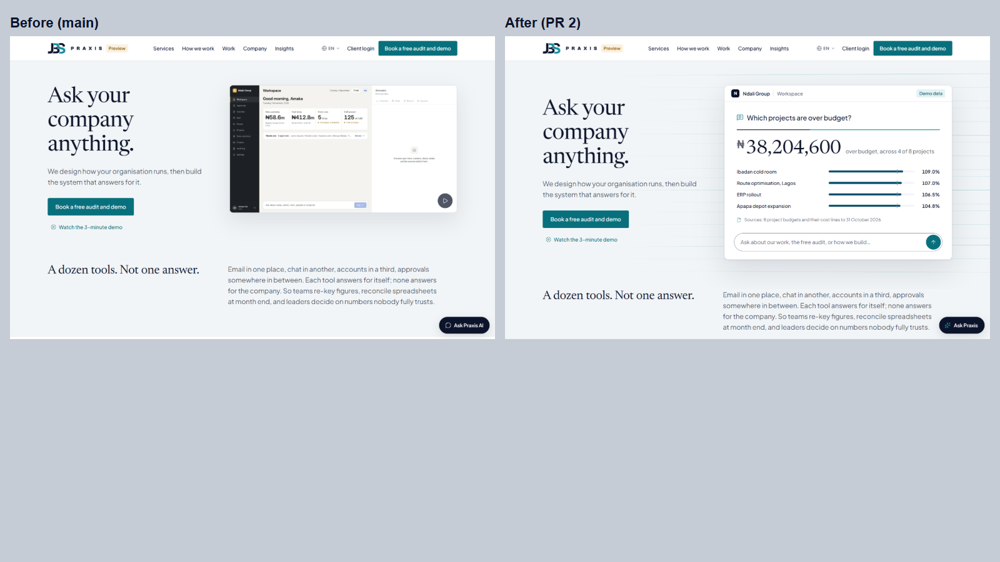
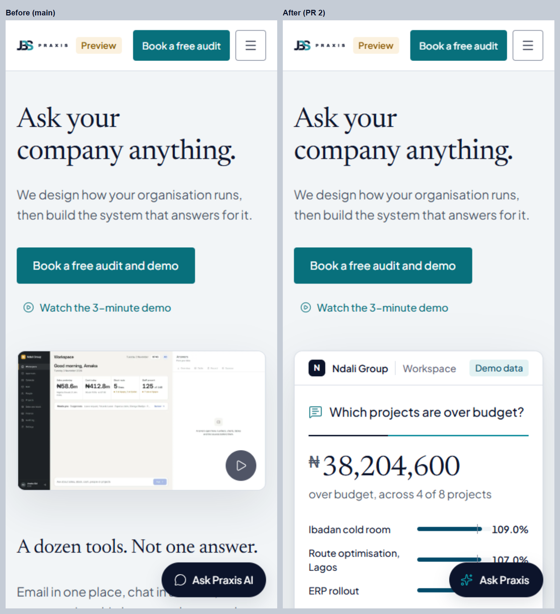
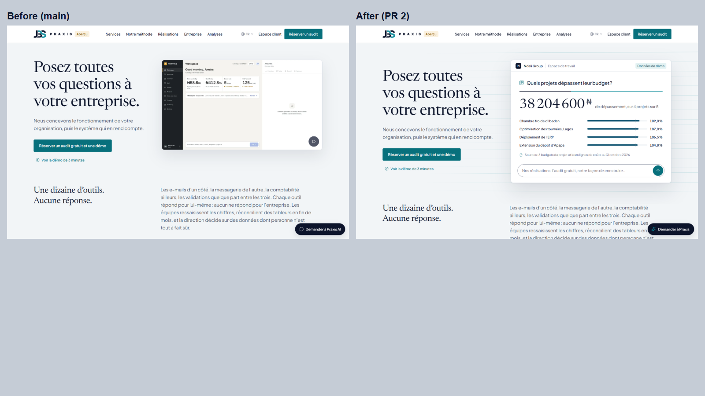

# Website redesign PR 2: motion, the hero moment and Ask Praxis

What the owner chose (4 Nov 2026, brand book v1.4, decisions 11 to 16):
- Cinematic motion on wide screens, with phones staying fast (mobile Lighthouse 90+).
- A hero that combines the live answer with the WebGL field.
- A Stripe-meets-McKinsey feel.
- "Ask Praxis" with a modern assistant feel.

## What a visitor sees

**The hero moment (every device).** The 6.4 MB screen-recording loop is gone. In its place is a framed answer, built in HTML, from the demo company (Ndali Group, labelled **Demo data**):
1. "Which projects are over budget?" fades in.
2. The Praxis rule draws from the question to the answer (1.2 s, Ink then Teal).
3. **₦38,204,600** settles from 97% of its value.
4. The four over-budget projects' bars grow against a 100% tick.
5. The sources appear.
6. The question box turns live. Whatever a visitor types there opens Ask Praxis and gets answered.

The figures come from the 60-second demo's own data. Every final value is in the HTML from the start, so screen readers, search engines, visitors without JavaScript and visitors who ask for reduced motion all get the finished frame.

**The quiet flow field (wide screens only).** One WebGL shader draws 22 fine lines behind the hero, Ink to Teal: the Praxis rule, multiplied. They arrive loose and converge into ordered rows over 1.6 s, then drift slowly, and lines near the pointer lift slightly. It runs at no more than 30 frames a second, pauses off screen, and falls back to a still drawing without WebGL.

**Scroll scenes (wide screens with a mouse or trackpad).**
- Smooth scrolling (Lenis, driven by GSAP's ticker).
- "A dozen tools. Not one answer." lights up word by word, from Muted to ink, as it passes.
- "How we work" holds in the centre while its four rules draw in turn and each step comes up to full colour.
- The hero eases away as you leave it.

**Drawing rules (every device).** Every Praxis rule (sections, domains, method steps, case-study rows, the work register, Industries) draws left to right as it comes into view, siblings 80 ms apart. This uses CSS transforms only; the script just adds a class.

**Page transitions (every device).** Same-site links cross-fade the page under a still header (cross-document view transitions). They're off with reduced motion, and older browsers simply load the page.

**Ask Praxis** (was "Ask Praxis AI"):
- Enter sends at once and the question appears straight away. Shift and Enter makes a new line.
- Three dots hold the assistant's place while it thinks.
- The reply writes in word by word.
- The composer grows as you type, and the panel opens smoothly.
- The hero's box hands its question over.

## Engineering
- **Motion code:** `resources/js/motion/`.
  - `index.js` picks the layers.
  - `hero.js` and `lite.js` run on every device; `app.js` is 8.7 KB gzip in all.
  - `cinematic.js` and `field.js` are a separate 51 KB gzip file. It loads only after the page, and only on screens 1080 px or wider with hover, a fine pointer and no Data Saver. Phones never download it (the test checks the HTML never references it).
- **CSP unchanged** (`style-src 'self'`): motion sets styles only from scripts (CSSOM), and the test checks there are no `style=` attributes and no inline scripts.
- **Speed work in this PR:**
  - The **₦ sign** is set in the system sans, because the brand faces keep ₦ in their latin-ext files (85 KB and 21 KB), which phones would otherwise fetch on first view for one glyph.
  - The **logo SVGs and the favicon** are optimised (SVGO, 2-decimal precision): 66 → 33 KB, 34 → 16 KB. Compared at 1800 px wide, at most 0.014% of pixel values differ, all on anti-aliased edges.
- **Accessibility:** words and steps waiting for the scroll sit in Muted (5.3:1 on Mist), never faded below AA. The first build faded them with opacity and Lighthouse caught it (96); fixed, now 100.
- **Brand book v1.4** (`docs/BRAND.md`): the cinematic layer (§11), Ask Praxis's word-by-word reply as the one exception to "no typewriter effects", the AI-generated place set (§10), the primary button decided as "Book a free audit" (applied in PR 3), and decisions 11 to 16.
- **Tests:** `MotionTest` adds 5 tests (the whole answer in EN and FR, the hero form, Ask Praxis, CSP with chapters, the cinematic layer never in the HTML). The hero tests were updated. The site suite has **194 passing**.

## Lighthouse, before (main, with PR 1) → after (PR 2)

Lighthouse 12.8, local server, same machine. SEO reads 69 locally only because local pages carry `noindex`.

| Page | Device | Perf | Accessibility | LCP | Page weight |
|---|---|---|---|---|---|
| Home | Phone | 90 → **92** | 100 → 100 | 3.3 → **2.9 s** | 438 → **351 KiB** |
| Home | Desktop | 100 → 100 | 100 → 100 | 0.7 → 0.7 s | 4,086 → **482 KiB** |
| Case study | Phone | 93 → 93 | 100 → 100 | 2.9 → 2.8 s | 417 → 349 KiB |
| Case study | Desktop | 100 → 99 | 100 → 100 | 0.6 → 0.7 s | 417 → 481 KiB* |
| Industries | Phone | 93 → 92 | 100 → 100 | 2.9 → 2.9 s | 427 → 360 KiB |
| Industries | Desktop | 100 → 100 | 100 → 100 | 0.6 → 0.7 s | 427 → 491 KiB* |
| Calculator | Phone | 93 → 93 | 100 → 100 | 2.8 → 2.9 s | 415 → 347 KiB |
| Calculator | Desktop | 100 → 100 | 100 → 100 | 0.6 → 0.7 s | 415 → 479 KiB* |

Best practices 100 everywhere. \* +51 KiB on desktop: the cinematic layer, loaded after the page.

## Screens (reduced motion, so the final state shows)

| | |
|---|---|
| Home, desktop |  |
| Home, phone |  |
| Home, French |  |

## Not in this PR (PR 3)
- Proof and conversion: the logo strip, quotes (hidden until approved), results (hidden until figures are confirmed), the place images on pages, the sticky header CTA, the calculator in the journey, and "Book a free audit" everywhere.
- Copy polish in EN and FR.
