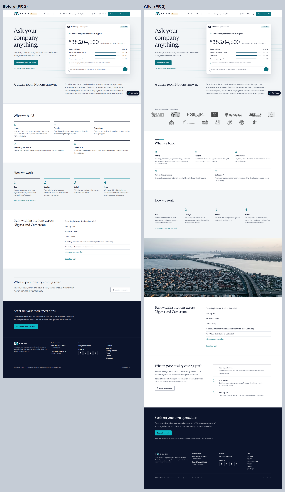
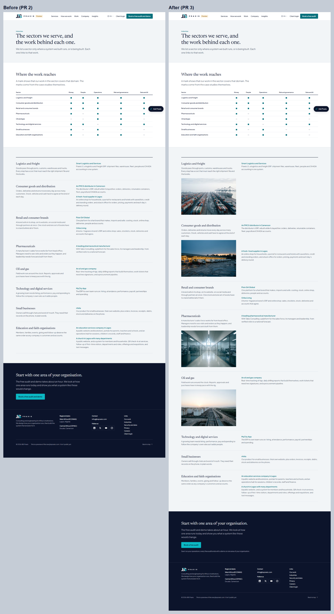
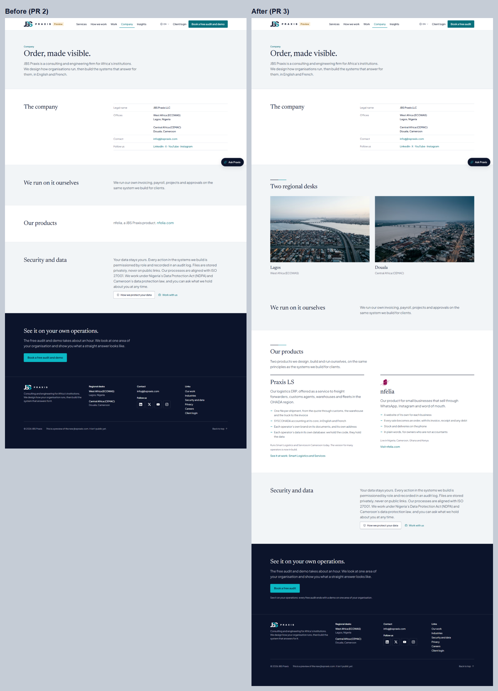
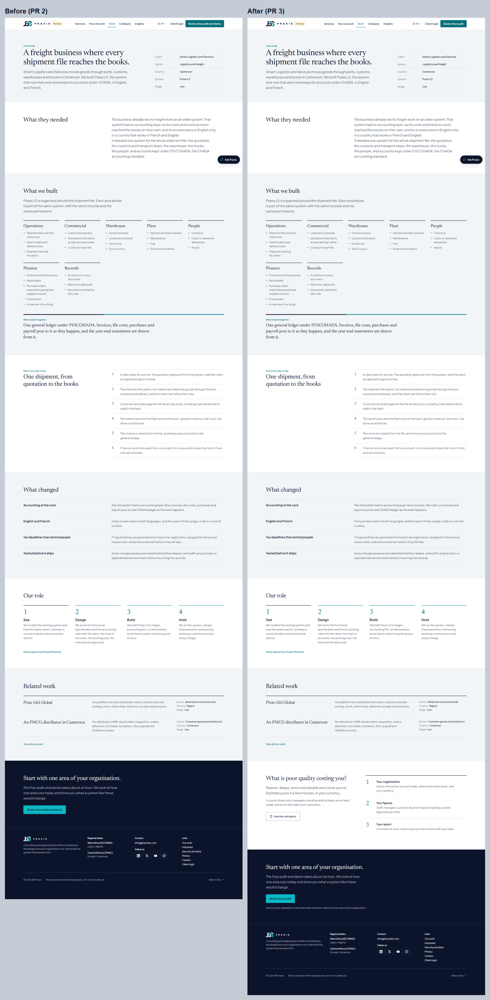

# Website redesign PR 3: proof and conversion

The third PR of the redesign, built on PR 1 (foundation) and PR 2 (motion). The owner's decisions (4 Nov 2026) shape it:
- all their logos in a scrolling strip, with no names shown;
- quotes and results only once approved;
- a sticky header CTA and the calculator built into the page flow;
- "Book a free audit" as the one primary button;
- Praxis LS presented as a product next to nfelia.

## What a visitor sees

**"Organisations we have worked with"** (homepage, under the opening statement).
- The owner's logos, set in one muted tone, drift slowly left to right. A logo comes to full colour on hover.
- No names are shown; each logo's name is its accessible name.
- The strip stops on hover or focus, and a button pauses it (WCAG 2.2.2). With reduced motion it's a still, wrapped row.
- Logos (config `site.clients`):
  - Smart Logistics and Services, MTN, Pixie Girl Global, MyCity App (the full wordmark), Wellsmart Drilling, Orika Living, Tales Consulting, Interworks Drill Tech, RN Afriluxe, HOD and OK Veggies.
  - La Petite Cour and Horizon Segment: their logos show, but their accessible names describe them ("An FMCG distributor in Cameroon", "An oil and gas services company"), because the owner keeps both described in text. The guard test that no page *names* La Petite Cour still passes.
  - Our own products, Praxis LS and nfelia, sit side by side at the end.
- **Praxis LS's logo is listed but waits for its file:** `public/img/clients/praxis-ls.webp`. A listed logo without a file is simply left out, so it appears the moment the file is added.

**Our products** (Company page, `#products`; linked from the Work page).
- Praxis LS and nfelia, each as a product of its own: what it is, four points, where it runs and a link.
- Praxis LS's text describes the product, not the client: one file per shipment, a SYSCOHADA core in EN and FR, each operator's own brand and address, and each operator's data in its own database.
- It says plainly that it **runs Smart Logistics and Services today** and that **the version for many operators is now in build**. It links to the Smart Logistics case study rather than repeating it.

**Client quotes** (homepage, after the work).
- Built and hidden. The drafts for Timothee Massomba, the FMCG distributor's chief executive (unnamed, as the client is described), Bode Oluwasanmi and Faitlyn Alex are in `lang/*/site.php`.
- A quote appears only when its key is added to `config('site.quotes_approved')`, which happens once that person has approved it in writing. The test proves nothing shows before then.

**Results** (each case study, above "What changed").
- Built and hidden. Confirmed figures go in `config('site.results')`, labelled in both languages. The form to collect them is `audit/2026-11-redesign/FIGURES_FORM.md`. No figure exists until a client confirms it.

**Place images.**
- **Industries:** one per sector we have (logistics, consumer goods, pharmaceuticals, oil and gas).
- **Company:** a new "Two regional desks" band (Lagos, Douala).
- **Homepage:** one full-bleed chapter opener (Lagos) before the work.
- All images are AVIF/WebP at three widths, lazy-loaded, with descriptions in EN and FR, and never presented as a client's site.

**Conversion.**
- **Sticky header:** stays on scroll and slims after the first few pixels, so "Book a free audit" is always one tap away.
- **The calculator in the journey:** a proper section on the homepage and on every case study. It says what the calculator counts (three costs) and its three real steps.
- **"Book a free audit"** everywhere a button, link or title says it: header, final calls to action, the booking page title and submit button, the footer link, the meta description and `llms.txt`. EN and FR.
  - The offer is still a free audit and demo. The booking page now opens with "The free audit takes about an hour and ends with a demo…".
  - The final call to action adds the owner's line: "See it on your operations: every free audit ends with a demo on one area of your organisation."

## Engineering
- **New partials:** `clients`, `quotes`, `calculator-band`; results block in `work/show`; products in `company`.
- **13 logos** trimmed and exported at 96 px high, 2–8 KB each (`public/img/clients`). No page has an inline style; the strict CSP is unchanged.
- **Tests:** `ProofTest` adds 8 tests (the strip and its accessible names, quotes only when approved, results only when confirmed, the button and its line, the calculator on home and case studies, place images, our products, sticky header and CSP). The old button wording was updated in 4 tests. The site suite has **202 passing**.

## Lighthouse, before (PR 2) → after (PR 3)

Lighthouse 12.8, local server, same machine. SEO reads 69 locally only because local pages carry `noindex`.

| Page | Device | Perf | Accessibility | LCP | Page weight |
|---|---|---|---|---|---|
| Home | Phone | 89 → **91** | 100 → 100 | 3.3 → 3.0 s | 510 → 351 KiB |
| Home | Desktop | 99 → 99 | 100 → 100 | 0.8 → 0.8 s | 821 → 482 KiB |
| Case study | Phone | 91 → 91 | 100 → 100 | 3.1 → 3.0 s | 357 → 349 KiB |
| Industries | Phone | 86 → **92** | 100 → 100 | 3.6 → 2.9 s | 569 → 360 KiB |
| Industries | Desktop | 99 → 100 | 100 → 100 | 0.8 → 0.7 s | 571 → 491 KiB |
| Calculator | Phone | 93 → 93 | 100 → 100 | 2.8 → 2.8 s | 353 → 347 KiB |

Best practices 100 everywhere. Weights fall because the new images load lazily; Lighthouse counts only what the first view loads.

## Screens (reduced motion, so the final state shows)

| | |
|---|---|
| Home, desktop |  |
| Home, phone |  |
| Industries |  |
| Company |  |
| Case study |  |

## For the owner after merge
- **Praxis LS logo:** save the light-mode logo as `audit/2026-11-redesign/logos/praxis-ls.png` (any size). It's then one command to export and ship.
- **Quotes:** when each person says yes, add their key to `config/site.php` → `quotes_approved`.
- **Figures:** fill in `FIGURES_FORM.md` with the clients; confirmed figures go in `config/site.php` → `results`.
